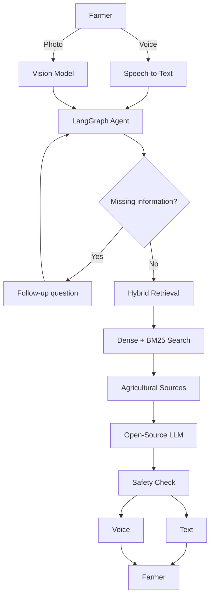
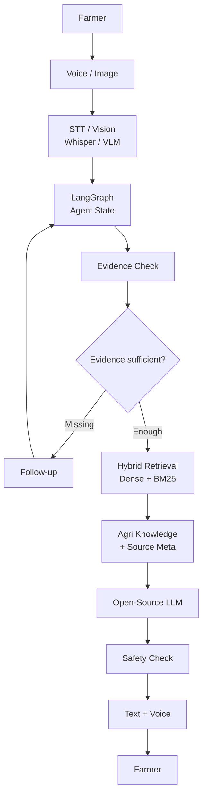
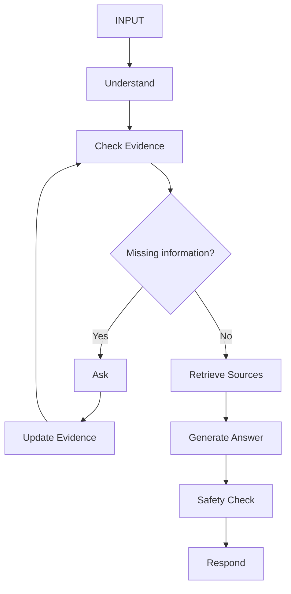

# 🌾 Krishi-Vaani

**Voice-First Crop Advisory Powered by Open-Source AI**

> Hacktober Fest 2026 — Track 1: Best Open-Source AI Project  
> Pilot Region: Vidarbha, Maharashtra  
> Pilot Crops: Cotton • Soybean • Tur • Orange  
> License: Apache-2.0

> «Speak about the problem. Show the crop. Get evidence-backed guidance.»

---

## 1. Problem Statement

Farmers can lose yield because crop diseases, pests, and nutrient problems are identified late or incorrectly. Getting quick expert advice is not always possible, especially for small and marginal farmers.

Existing digital tools can also be difficult when the farmer has to type in English, describe symptoms technically, or interpret long text-based answers.

Krishi-Vaani focuses on this gap: simple, voice-first and image-assisted crop guidance in a farmer-friendly interaction.

---

## 2. Project Overview

Krishi-Vaani is an open-source AI system that lets a farmer:

**🎙️ Speak in Marathi/Hindi + 📷 Upload a crop photo**

The system combines speech recognition, vision, retrieval and language models to understand the situation and provide a concise, evidence-backed response.

If the available information is not enough, it asks a targeted follow-up question instead of guessing.

---

## 3. Proposed Solution

The key idea is not simply “ask an LLM about farming.”

The system connects multimodal input + retrieval + agentic reasoning + source grounding + safety checks into one workflow.

---

## 4. Objectives

- Make crop advisory accessible through voice and images.
- Support Marathi/Hindi interaction.
- Use open-source/open-weight AI throughout the core pipeline.
- Ground answers in curated agricultural information.
- Ask for missing information instead of confidently guessing.
- Prevent unsupported specific chemical/dose recommendations.
- Build a modular system that can be evaluated and extended.

---

## 5. Target Users / Use Case

### Primary Users

- Small and marginal farmers
- Farmers with limited access to agricultural experts
- Users who prefer speaking over typing

### Example

A farmer notices unusual spots on cotton leaves.

**Photo + short voice message → AI analysis → relevant evidence → simple response**

If the image alone is ambiguous, Krishi-Vaani may ask:

> «“Are the spots also appearing on the newer leaves?”»

The answer is then updated using the additional information.

---

# AI & ENGINEERING

## 6. Open-Source AI Technology Selected

| Technology | Role |
|---|---|
| faster-whisper | Voice → text |
| Qwen2.5-VL | Crop image analysis |
| Qwen2.5 7B Instruct | Reasoning + response generation |
| multilingual-e5 / BGE-M3 | Semantic retrieval |
| Chroma + BM25 | Hybrid knowledge retrieval |
| LangGraph | Stateful agent workflow |
| Piper | Text → voice |
| Ollama / llama.cpp | Local model inference |

---

## 7. Why These Technologies Were Selected

The project deliberately avoids making a closed API the core of the system.

- Whisper gives an open speech-to-text layer.
- Qwen2.5-VL allows visual crop evidence to be considered.
- Qwen2.5 7B provides a practical open language model for reasoning.
- Dense + BM25 retrieval combines semantic matching with exact agricultural terminology.
- LangGraph allows the system to maintain state and ask follow-up questions.
- Piper provides an open text-to-speech option.

This combination makes the system more than a single-model chatbot.

---

## 8. AI's Role in the System

AI is involved at every important decision point:

**Speech → understand the farmer**  
**Vision → observe visible symptoms**  
**Retrieval → find supporting evidence**  
**LLM → reason over evidence**  
**Agent → decide whether more information is needed**  
**Safety layer → check generated advice**  
**TTS → communicate the result through voice**

---

## 9. System Architecture

---

## 10. Component-Level Architecture

| Component | Responsibility |
|---|---|
| React PWA | Voice recording, image upload, response display |
| FastAPI | Application/API layer |
| Speech Module | Voice transcription |
| Vision Module | Crop image observations |
| LangGraph | Workflow and state |
| Retriever | Dense + BM25 search |
| Chroma | Vector storage |
| LLM | Evidence-based response |
| Safety Layer | Detect unsupported risky advice |
| Piper | Spoken response |
| Docker | Reproducible deployment |

---

## 11. Data / Information Flow

1. Farmer provides voice, image, or both.
2. Voice is transcribed and image symptoms are analyzed.
3. LangGraph combines the available evidence.
4. Missing critical information is identified.
5. A short follow-up question is asked when required.
6. Relevant agricultural documents are retrieved using dense + BM25 search.
7. The open-source LLM generates a response using the retrieved evidence.
8. A safety check validates the response.
9. The answer is returned as text and/or voice.

---

## 12. Agentic Workflow

The agentic part is important because the system does not have to produce an answer immediately. It can gather better evidence first.

---

## 13. Technology Stack

**Frontend:** React, PWA  
**Backend:** FastAPI  
**Agent:** LangGraph  
**AI:** faster-whisper, Qwen2.5-VL, Qwen2.5 7B  
**Retrieval:** multilingual-e5/BGE-M3, Chroma, BM25  
**TTS:** Piper  
**Runtime:** Ollama / llama.cpp  
**Documents:** PyMuPDF, Tesseract  
**Deployment:** Docker  
**Optional:** Telegram

---

## 14. Expected Features

- 🎙️ Voice-first interaction
- 📷 Crop image analysis
- 🌐 Marathi/Hindi support
- 🔎 Evidence-grounded answers
- 💬 Targeted follow-up questions
- 📚 Source traceability
- 🛡️ Safety-aware agricultural guidance
- 🔊 Voice responses
- 🔌 Modular open-source architecture

---

# IMPLEMENTATION & IMPACT

## 15. Implementation Approach

### Phase 1 — Knowledge Base

Collect, clean and index relevant agricultural documents with source metadata.

### Phase 2 — AI Pipeline

Integrate speech, vision, LLM and retrieval components.

### Phase 3 — Agent

Implement the LangGraph workflow for evidence checking and follow-up questions.

### Phase 4 — Interface

Build the React PWA for voice, images and responses.

### Phase 5 — Safety & Evaluation

Test hallucinations, ambiguous cases, unsafe recommendations, retrieval quality and latency.

### Phase 6 — Deployment

Package the system with Docker and test the complete farmer workflow.

---

## 16. Expected Final Output

A working prototype where a farmer can:

**Speak → Upload a crop image → Answer a follow-up if needed → Receive simple, evidence-backed guidance → Listen to the response**

The system should also be able to communicate uncertainty and recommend expert verification when the available evidence is insufficient.

---

## 17. Future Scope / Scalability

The same architecture can later support:

- more crops and Indian languages
- offline/low-connectivity deployments
- weather and soil context
- farmer history and seasonal context
- additional agricultural knowledge sources
- KVK/agricultural officer escalation
- improved regional speech and vision models

These are planned extensions rather than claims about the first prototype.

---

## 18. Open-Source Dependencies / Components

The project is built around open-source/open-weight components including:

**faster-whisper • Qwen2.5-VL • Qwen2.5 • multilingual-e5/BGE-M3 • Chroma • BM25 • LangGraph • Piper • FastAPI • React • PyMuPDF • Tesseract • Docker • Ollama/llama.cpp**

Each dependency will be used according to its applicable license. The project is intended to use Apache-2.0 where compatible.

---

## 19. Expected Challenges and Mitigation

| Challenge | Mitigation |
|---|---|
| Noisy/regional speech | Measure WER and tune speech processing |
| Similar-looking symptoms | Combine image + voice + retrieved evidence |
| Missing information | Targeted follow-up questions |
| LLM hallucination | Retrieval-grounded generation |
| Unsafe chemical advice | Safety checks + source-supported information only |
| Poor images | Request clearer image/additional description |
| Retrieval failure | Dense + BM25 hybrid retrieval |
| Slow inference | Benchmark and optimize model/runtime choices |

---

## 20. Evaluation Plan

The prototype will be evaluated using:

- WER — speech transcription quality
- Top-1 / Top-3 accuracy — crop/symptom identification
- Retrieval relevance — quality of retrieved agricultural evidence
- Answer faithfulness — whether responses are supported by sources
- Safety rate — target zero unsourced specific chemical/dose recommendations
- Latency — end-to-end response time

### Ablation Tests

We will compare:

**LLM-only vs RAG**  
**Dense retrieval vs Dense + BM25**  
**Text-only vs Voice + Image**  
**No follow-up vs Agentic follow-up**

This helps show whether the project's individual engineering choices actually improve the system.

---

# Why Krishi-Vaani Fits PS1

Krishi-Vaani is not simply a chatbot with an AI API attached.

Open-source AI is central to the complete pipeline:

**«Speech → Vision → Retrieval → Agent → Reasoning → Safety → Voice»**

The project combines multiple open-source/open-weight models with meaningful engineering around multimodal input, hybrid retrieval, stateful agents, source grounding and safety.

The architecture is also modular, making it possible to test individual components, replace models and extend the system to additional crops and languages.

---

# 🛡️ Safety

Krishi-Vaani should never invent pesticide names, quantities or application doses.

Specific chemical guidance should only be provided when supported by the retrieved agricultural source. Otherwise, the system should provide general safe guidance and recommend verification from a qualified agricultural professional or nearby KVK/agriculture officer.

Krishi-Vaani is an advisory assistant, not a replacement for professional agricultural diagnosis.

---

# Disclaimer

This is a prototype for educational, research and hackathon purposes. Agricultural decisions, especially chemical treatment, should be verified with qualified professionals.

---

# License

Apache License 2.0, subject to compatibility with third-party model and dependency licenses.

---

# Team

**Team Seven Stars**  
Hacktober Fest 2026 — Best Open-Source AI Project
